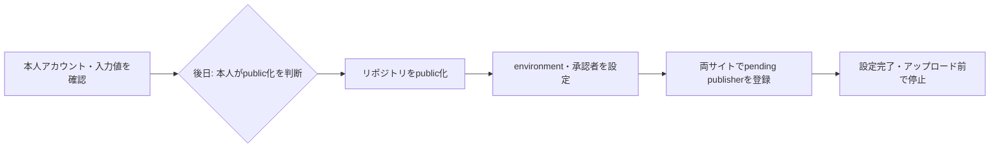

# 本人が行う公開設定の手順

手順作成日：2026-10-18。対象は`nibuno/django-ninja-ulid`、初回版は`0.1.0`。

PyPIとTestPyPIは本人の個人アカウントで所有し、追加メンテナーを置かない。本番のPyPI公開にはGitHubで本人の承認を必須にする。この方針は決定済みである。

**2026-10-19追記：public化・両サイトのpending publisher登録・GitHubのenvironment設定をブラウザで確認済み。TestPyPIの公開ワークフローを有効化した。本番PyPIの送信は無効。** 以下は初回設定時の手順であり、現在の公開手順は[リリース手順](releasing.md)を参照する。

## 設定の順序

本人のアカウントと入力値を確認し、public化を行う時点を本人が決めてから、GitHubのenvironmentとTrusted Publisherを設定する。設定が終わっても、アップロード前で止める。

編集元は[publishing-setup.mmd](assets/publishing-setup.mmd)。GitHub Free・Pro・Teamでは必須レビュアーがpublicリポジトリに限られるため、この手順ではpublic化の後に承認設定を行う。privateのまま設定項目が表示されない場合に、承認を省略して進める手順にはしない。[GitHubの利用条件](https://docs.github.com/en/actions/how-tos/deploy/configure-and-manage-deployments/manage-environments)

## 登録時に入力する値

Trusted Publisherの「GitHub Actions」フォームには、次を入力する。

| 入力欄 | TestPyPI | 本番PyPI |
|---|---|---|
| PyPI project name（新規作成の場合） | `django-ninja-ulid` | `django-ninja-ulid` |
| Owner | `nibuno` | `nibuno` |
| Repository name | `django-ninja-ulid` | `django-ninja-ulid` |
| Workflow name | `publish.yml` | `publish.yml` |
| Environment name | `testpypi` | `pypi` |

`Owner`欄はGitHubの所有者名である。PyPI・TestPyPIでの所有者は、それぞれのサイトでログインしている本人アカウントになるため、両者を区別する。本人のPyPI・TestPyPIのユーザー名はまだ取得していないので、最初の手順で確認する。

`Workflow name`はファイル名だけを入力する。将来の公開ファイルは`.github/workflows/publish.yml`であり、現在の`prepare-release.yml`や無効テンプレートのファイル名を登録するものではない。Environment nameは任意欄として表示されても、今回の構成では上表の値を入れる。[GitHub Actions用の登録項目](https://docs.pypi.org/trusted-publishers/adding-a-publisher/)

版`0.1.0`と予定タグ`v0.1.0`は、後の公開で使う値であり、Trusted Publisherフォームの入力項目ではない。認証はOIDCを使うため、この構成で登録するAPIトークンはない。[Trusted Publishingの認証](https://docs.pypi.org/trusted-publishers/using-a-publisher/)

## 1. 本人のアカウントを確認する

1. [PyPI](https://pypi.org/)と[TestPyPI](https://test.pypi.org/)へ、それぞれ本人の個人アカウントでログインする。アカウントがなければ、本人が登録する。
2. 各サイトのユーザー名を確認し、どのアカウントで登録するかを記録する。PyPIとTestPyPIは別サービスなので、両方へのログインを確認する。[TestPyPIの説明](https://packaging.python.org/en/latest/guides/using-testpypi/)
3. PyPIではメール確認と2要素認証を済ませる。TestPyPIでもメール確認と、その画面で求められる認証設定を済ませる。[PyPIのメール確認・2要素認証](https://pypi.org/help/#twofa)

この段階で確認するのはアカウント名と認証状態である。プロジェクトへの共同管理者の招待は行わない。

## 2. 後日、本人がリポジトリをpublic化する

**この操作は、本人がpublic化を行う時点を決めるまで実施しない。** 対象はパッケージ用の`nibuno/django-ninja-ulid`であり、元の学習用リポジトリではない。

1. 公開するソースと履歴を確認する。public化するとActionsの履歴・ログも閲覧対象になる。
2. [リポジトリのSettings](https://github.com/nibuno/django-ninja-ulid/settings)を開き、Generalの下部にあるDanger Zoneへ進む。
3. Change repository visibility → Change visibilityからpublicを選ぶ。
4. 対象が`nibuno/django-ninja-ulid`であることと変更内容を確認し、画面の確認操作を完了する。
5. リポジトリにPublicと表示されることを確認する。

これはGitHub上のコードを公開する操作であり、PyPIへのアップロードは伴わない。[GitHubの変更手順と公開対象](https://docs.github.com/en/repositories/managing-your-repositorys-settings-and-features/managing-repository-settings/setting-repository-visibility)

## 3. GitHubのenvironmentと承認者を設定する

[Settings → Environments](https://github.com/nibuno/django-ninja-ulid/settings/environments)でNew environmentを選び、`testpypi`と`pypi`を作成する。保存する値は次のとおり。

| 設定 | `testpypi` | `pypi` |
|---|---|---|
| Required reviewers | 指定しない。本番のみ必須とする方針 | 有効にし、`nibuno`を指定 |
| Prevent self-review | 有効にしない | **チェックを外す** |
| Allow administrators to bypass configured protection rules | 表示される場合は無効 | **チェックを外す** |
| Deployment branches and tags | Selected branches and tags | Selected branches and tags |
| 追加するルールのRef type | Tag | Tag |
| 追加するルールのName pattern | `v*` | `v*` |
| Environment secrets | 今回のTrusted Publishing用には追加不要 | 今回のTrusted Publishing用には追加不要 |

`pypi`では、本人が起動したrunを本人が承認できるよう、Prevent self-reviewを無効にする。管理者による承認の迂回も無効にし、毎回本人のレビュー操作を必要にする。[承認者と迂回の設定](https://docs.github.com/en/actions/how-tos/deploy/configure-and-manage-deployments/manage-environments)

Deployment branches and tagsでは、ブランチとタグを別々に登録する。今回はRef typeがTag、Name patternが`v*`のルールを保存する。`main`のブランチルールを登録する設定ではない。[タグ制限の登録](https://docs.github.com/en/actions/how-tos/deploy/configure-and-manage-deployments/manage-environments)

保存後は`pypi`を開き直し、Required reviewersに`nibuno`、自己レビュー禁止と管理者迂回が無効、許可タグが`v*`になっていることを確認する。この時点では送信jobを実行せず、設定の表示を確認するところまでとする。

## 4. 両サイトにTrusted Publisherを登録する

新規プロジェクトの場合は、本人アカウントのPublishingからpending publisherを登録する。PyPIとTestPyPIでそれぞれ行う。

1. [PyPIのアカウントPublishing](https://pypi.org/manage/account/publishing/)を開く。TestPyPIは[同サイトのPublishing](https://test.pypi.org/manage/account/publishing/)を開く。ログインが必要な場合は、手順1で確認した本人アカウントを使う。
2. 新規のpending publisherを追加する欄で、GitHub Actionsを選ぶ。
3. 「登録時に入力する値」の表から、対象サイトの列の値を入力する。
4. Addで登録し、一覧にプロジェクト名・Owner・repository・workflow・environmentが保存されたことを確認する。
5. もう一方のサイトでも、そのサイトのEnvironment nameを使って登録する。

pending publisherは、初回アップロードでプロジェクトを作成するための登録である。**登録だけではプロジェクトの作成や名前の予約はされず、パッケージも公開されない。** 既に別の所有者が同名を利用している場合は登録を進めず、名前と所有状態を確認する。[新規プロジェクトの登録仕様](https://docs.pypi.org/trusted-publishers/creating-a-project-through-oidc/)

既に本人が所有する同名プロジェクトがある場合は、pending publisherではなくYour projects → Manage → Publishingから追加する。GitHub側の入力値は同じである。[既存プロジェクトへの追加](https://docs.pypi.org/trusted-publishers/adding-a-publisher/)

公開ワークフローはまだ有効化しない。登録時に指定する`publish.yml`は後日有効にする公開ファイル名であり、登録のために今すぐ送信jobを起動する必要はない。

## 5. 設定完了を確認し、公開前で止める

本人の設定後は、次の項目を確認する。

- 本人のPyPI・TestPyPIのアカウント名と、それぞれにログインできること。
- GitHubの公開状態と、`pypi`の承認者が`nibuno`であること。
- `pypi`の自己レビュー禁止・管理者迂回が無効で、許可タグが`v*`であること。
- 両サイトのpublisherが入力表どおりに登録され、Environment nameがそれぞれ異なること。
- `publish.yml.disabled`の配置と両送信jobの無効化を維持していること。

設定が終わったら、本人から「設定完了」とアカウント名・設定状況を共有する。この段階では、公開テンプレートの有効化、タグの作成・push、TestPyPIへのアップロードはまだ実施しない。これらは[リリース手順](releasing.md)に沿って、実施の指示を受けてから進める。

初回アップロード後は、各プロジェクトの管理画面で本人だけがOwnerになっていることと、pending publisherが通常のpublisherへ移行したことも確認する。これは登録時ではなく、後の初回公開時の確認事項である。

## 後日の本番公開で本人が行う承認

将来TestPyPIでの検証に成功し、本番のjobが承認待ちになった時点で、本人がActionsの該当runを開く。Review deploymentsで`pypi`を選び、対象commit・版・配布物のSHA256とTestPyPIの結果を確認してからApprove and deployを選ぶ。この承認が、本番PyPIへ送信する実施判断になる。[GitHubの承認操作](https://docs.github.com/en/actions/how-tos/deploy/configure-and-manage-deployments/review-deployments)

現在はそのrunを起動していない。登録設定の確認と、OIDC認証・承認待ち・送信の動作確認は別に扱い、後者は実際の実施時に記録する。
