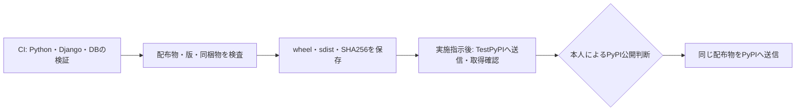

# リリースの準備と公開手順

更新日：2026-10-18。初回版は`0.1.0`。現在は配布物の検査までを実施し、リポジトリのpublic化、TestPyPI・PyPIへのアップロード、公開タグのpushは実施待ちとする。

## 現在実行できる準備

[Prepare release](../.github/workflows/prepare-release.yml)は、手動実行または他のワークフローからの呼び出しで、配布物の作成・メタデータ検査・新規インストール・SHA256の記録を行う。公開先への認証やアップロード処理は含めず、権限は`contents: read`に限る。予定タグ`v0.1.0`を渡して照合しても、Gitタグは作成しない。



編集元は[release-flow.mmd](assets/release-flow.mmd)。現在有効なのはCIとPrepare releaseであり、公開処理は下記の無効なテンプレートに残している。手動のPrepare releaseはCIを自動で再実行しないため、候補として採用する際は同じcommitのCI成功も確認する。

### ローカルでの配布物検査

過去の版を同じ出力先へ混ぜず、版ごとに新しいディレクトリを使う。

```bash
uv sync --locked --extra orm
uv build --out-dir local-checks/release-0.1.0/dist
uv run --locked --extra orm twine check local-checks/release-0.1.0/dist/*
python3 scripts/check_release.py --dist-dir local-checks/release-0.1.0/dist --manifest local-checks/release-0.1.0/release-manifest.json --tag v0.1.0
python3 scripts/check_release.py --verify --dist-dir local-checks/release-0.1.0/dist --manifest local-checks/release-0.1.0/release-manifest.json
```

ローカルの作業中のコードでは`source_commit`を空にする。GitHub Actionsで作るmanifestには、実際にチェックアウトしたcommitを記録する。

検査では、ソース・予定タグ・wheel・sdistの版、配布名、CHANGELOGの該当節、MITと`py.typed`の同梱、配布物のSHA256を確認する。誤ったタグ、別の版の混在、メタデータの不一致、同梱漏れ、ファイルの変更を拒否する。README等の表示は`twine check`で検査するが、外部リンク先まで取得して検証するものではない。

Actionsの成果物は`release-<version>-<commit>`の名前で30日間保存し、次を含む。

- `dist/`：wheelとsdist。
- `release-manifest.json`：版・予定タグ・commit・ファイル名・SHA256。
- `orm-install.json`・`type-install.json`：新規プロジェクトとextraなしの確認結果。

期限切れや修正によって作り直した配布物は、新しい候補として再確認する。TestPyPIで検証した後に、同じ候補として再ビルドしない。

## 無効な公開テンプレート

[publish.yml.disabled](../workflow-templates/publish.yml.disabled)は`.github/workflows`の外に置いているため、GitHub Actionsとして起動しない。TestPyPIとPyPIの両アップロードjobにも`if: false`を指定している。外部設定と実施の判断が済むまで、この配置と無効化を維持する。

将来有効化する構成は、タグでCIを通し、Prepare releaseを呼んで配布物を一度だけ作り、TestPyPIでの取得・SHA256照合・新規プロジェクト確認を経て、同じ成果物をPyPIへ送るものである。送信先ごとに`testpypi`・`pypi`のenvironmentを使い、PyPIの送信前は本人の承認を必須にする。

ビルドと公開は別jobにする。OIDCの`id-token: write`は通常の公開jobだけに与え、再利用可能なワークフローはCIとビルドに限る。これは[PyPA Actionの説明](https://github.com/pypa/gh-action-pypi-publish#trusted-publishing)に従う。送信処理とTestPyPIからの取得はまだ実行しておらず、テンプレートの構文・無効化の確認までが今回の範囲である。

テンプレートの両送信jobを有効にする前に、`pypi` environmentの承認を実際に要求できることを確認する。environment名を書くだけでは承認を必須にできない。現在はenvironmentの作成・設定を行っていない。[GitHubのenvironment設定](https://docs.github.com/en/actions/how-tos/deploy/configure-and-manage-deployments/manage-environments)

GitHub Free・Pro・Teamでは、必須レビュアーはpublicリポジトリに限られる。リポジトリは2026-10-19にpublicへ変更したため、`pypi` environmentに承認設定を行ってから公開処理を有効にする。承認者が本人だけの場合は、自身が起動したrunを承認できる設定にする。[利用条件と自己承認の設定](https://docs.github.com/en/actions/how-tos/deploy/configure-and-manage-deployments/manage-environments)

ローカルの構文検査にはactionlint 1.7.12を使った。テンプレートの意図した`if: false`だけを除外するため、次のように検査を分ける。

```bash
actionlint -shellcheck= -pyflakes= .github/workflows/ci.yml .github/workflows/prepare-release.yml
actionlint -shellcheck= -pyflakes= -ignore 'constant expression "false" in condition' workflow-templates/publish.yml.disabled
```

## 決定した所有者・承認方針と本人の設定

PyPI・TestPyPIは本人の個人アカウントで所有し、追加メンテナーを置かない。GitHubでは`testpypi`と`pypi`を分け、本番の`pypi`は本人`nibuno`の承認を必須にする。この方針は了承済みである。

具体的な入力値と操作順序は、[本人が行う公開設定の手順](publishing-setup.md)にまとめた。アカウントの確認、後日のpublic化、environmentと承認者、両サイトのpending publisher登録までを扱う。

両サイトの実際のアカウント名と設定状態は未確認である。現在は手順の作成までで止め、外部設定・public化・アップロードは実施していない。設定完了後も、公開テンプレートの有効化とTestPyPIへのアップロードには別途実施の指示が必要である。

TestPyPIからの検証では、依存を通常のPyPIからロックどおりに導入し、対象パッケージだけをTestPyPIから`--no-deps`で取得する。テンプレートは取得したwheelのSHA256を準備済みmanifestと照合する。PyPIへの送信は、その確認に成功した同じwheel・sdistを対象にする。[TestPyPIの利用手順](https://packaging.python.org/en/latest/guides/using-testpypi/)、[PyPAの公開手順](https://packaging.python.org/en/latest/guides/publishing-package-distribution-releases-using-github-actions-ci-cd-workflows/)
