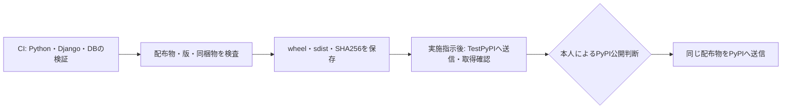

# リリースの準備と公開手順

更新日：2026-10-20。`0.1.0`は公開済み。次の候補は文書・メタデータを更新した`0.1.1`。TestPyPIへの送信・取得確認を有効化し、本番PyPIへは検証済みの配布物を使い、手動実行とenvironmentの承認を経て送信する。

## 0.1.1の準備と公開の順序

`0.1.1`はREADMEの英語化、日本語版の追加、PyPIメタデータの更新を配布するパッチ版である。公開API・実装・依存条件は変更しない。版を上げるのは、公開済みの`0.1.0`を別の内容で再公開しないためである。

### 1. ソースと配布物を確認する（アップロードなし）

1. [README整備のPR #2](https://github.com/nibuno/django-ninja-ulid/pull/2)と、`0.1.1`の版・ロックファイル・CHANGELOG・手順を更新するPRを確認してmainへ取り込む。
2. 公開対象のcommitでCIの全12通りが成功していることを確認する。
3. 同じcommitのPrepare releaseを実行し、配布物、通常インストール、ORM extraなしの利用、SHA256を確認する。

```bash
gh workflow run prepare-release.yml --ref main -f release_tag=v0.1.1
```

PRブランチでも同じワークフローを実行できる。その結果は事前検証であり、マージ後の公開対象commitの確認とは区別する。Prepare releaseはタグを作らず、TestPyPIにもPyPIにも送信しない。

### 2. TestPyPIで確認する（実施指示後）

公開対象のcommitを確定し、本人からTestPyPIへの公開指示を受けてから`v0.1.1`タグを作成・pushする。`v*`タグのpushは公開ワークフローを起動するので、準備だけの段階では行わない。

タグを契機に、CI、Prepare release、TestPyPIへのアップロード、ダウンロードしたwheelのSHA256照合、新規Djangoプロジェクトでの検証が順に実行される。この実行で作ったwheel・sdistを正式な公開候補とする。手順1で作った事前検証用の配布物とは区別し、以後は再ビルドせず、この候補を本番へ送る。

確認する内容は次のとおり。

- `Publish`全体と`check-testpypi`が成功している。
- manifestの版が`0.1.1`、予定タグが`v0.1.1`、`source_commit`が公開対象のcommitと一致する。
- wheelのSummaryと説明本文が、更新した`pyproject.toml`と英語READMEに一致する。
- sdistに`README.md`と`README.ja.md`が含まれる。
- TestPyPIの説明が英語で表示され、日本語版へのリンクが使える。

公開後に内容を変更する必要が生じた場合は、同じ版の配布物を差し替えず、次の版を用意する。

### 3. 検証した候補を本番公開用に固定する

現在の`publish.yml`の手動公開経路は、下記の実行記録にある`0.1.1`の検証済み候補に固定している。`v0.1.1`タグをpushしただけでは、本番PyPIには公開されない。

候補を固定するときは、TestPyPI検証の成功後に次の変更を別のPRで確認する。run ID・artifact ID・SHA256は成功した実行から取得し、事前に仮の値を設定しない。今回の`0.1.1`も、この手順で固定した。

1. その実行の`release-manifest.json`を、内容を変えず`release-candidates/0.1.1.json`として保存する。
2. `verify-promotion`と`pypi`が参照するrun ID・artifact ID・manifest・版を、その候補に更新する。元runの成功、`check-testpypi`の成功、元commitの一致を検査する条件も更新する。
3. 手動実行を許可するタグを`v0.1.1-publish.1`へ更新する。`pypi` environmentの本人承認は維持する。
4. 変更をmainへ取り込み、そのcommitに公開操作用タグ`v0.1.1-publish.1`を付ける。ソースタグ`v0.1.1`は動かさない。

`v*-publish.*`のタグpushではTestPyPIへの再送信は起きない。公開操作用タグは候補を照合・送信するワークフローの版を固定するためのものであり、配布物のソースcommitを変更するものではない。

### 4. 本人の承認を経てPyPIへ公開する

```bash
gh workflow run publish.yml --ref v0.1.1-publish.1
```

この操作は手順3の変更を取り込んだ後に行う。候補の照合に成功すると`pypi` jobが承認待ちになる。本人が対象版・元commit・配布物のSHA256・TestPyPIの結果を確認し、GitHubのReview deploymentsで承認すると、本番への送信が始まる。

公開後はPyPIの`0.1.1`、配布物のSHA256、英語の説明と日本語版へのリンクを確認し、CHANGELOGの「未公開」を実際の公開日に更新する。

### 0.1.1のTestPyPI検証記録

2026-10-20に[Publish run 39404044826](https://github.com/nibuno/django-ninja-ulid/actions/runs/39404044826)が成功した。12通りのCI、配布物の作成、TestPyPIへの送信、取得したwheelのSHA256照合、新規Djangoプロジェクトでの確認を完了している。

| 項目 | 固定した値 |
|---|---|
| ソースタグ | `v0.1.1` |
| ソースcommit | `56ef3a73dd270f9d9f46e35f5e1f87237c05aa3f` |
| 元のrun ID | `39404044826` |
| artifact ID | `12255538139` |
| manifest | [release-candidates/0.1.1.json](../release-candidates/0.1.1.json) |
| 公開操作用タグ | `v0.1.1-publish.1` |

[TestPyPIの0.1.1](https://test.pypi.org/project/django-ninja-ulid/0.1.1/)で、wheel・sdistのSHA256と英語の説明本文が候補に一致することを確認した。日本語READMEのsdistへの同梱、ORMあり・なしの通常インストールも確認済みである。

本番公開では、上記artifactから同じwheel・sdistを取得する。公開操作のソースから再ビルドしない。artifactが期限切れ・削除済みの場合や、元run・manifest・SHA256が一致しない場合は停止する。本番への送信には`pypi` environmentで本人の承認が必要になる。

## 現在実行できる準備

[Prepare release](../.github/workflows/prepare-release.yml)は、手動実行または他のワークフローからの呼び出しで、配布物の作成・メタデータ検査・新規インストール・SHA256の記録を行う。公開先への認証やアップロード処理は含めず、権限は`contents: read`に限る。予定タグ`v0.1.1`を渡して照合しても、Gitタグは作成しない。



編集元は[release-flow.mmd](assets/release-flow.mmd)。CI・Prepare release・TestPyPIへの公開ワークフローを有効にしている。手動のPrepare releaseはCIを自動で再実行しないため、候補として採用する際は同じcommitのCI成功も確認する。

### ローカルでの配布物検査

過去の版を同じ出力先へ混ぜず、版ごとに新しいディレクトリを使う。

```bash
uv sync --locked --extra orm
uv build --out-dir local-checks/release-0.1.1/dist
uv run --locked --extra orm twine check local-checks/release-0.1.1/dist/*
python3 scripts/check_release.py --dist-dir local-checks/release-0.1.1/dist --manifest local-checks/release-0.1.1/release-manifest.json --tag v0.1.1
python3 scripts/check_release.py --verify --dist-dir local-checks/release-0.1.1/dist --manifest local-checks/release-0.1.1/release-manifest.json
```

ローカルの作業中のコードでは`source_commit`を空にする。GitHub Actionsで作るmanifestには、実際にチェックアウトしたcommitを記録する。

検査では、ソース・予定タグ・wheel・sdistの版、配布名、CHANGELOGの該当節、MITと`py.typed`の同梱、配布物のSHA256を確認する。誤ったタグ、別の版の混在、メタデータの不一致、同梱漏れ、ファイルの変更を拒否する。README等の表示は`twine check`で検査するが、外部リンク先まで取得して検証するものではない。

Actionsの成果物は`release-<version>-<commit>`の名前で30日間保存し、次を含む。

- `dist/`：wheelとsdist。
- `release-manifest.json`：版・予定タグ・commit・ファイル名・SHA256。
- `orm-install.json`・`type-install.json`：新規プロジェクトとextraなしの確認結果。

期限切れや修正によって作り直した配布物は、新しい候補として再確認する。TestPyPIで検証した後に、同じ候補として再ビルドしない。

## TestPyPIへの公開

[Publish](../.github/workflows/publish.yml)は`v*`タグのpushで起動する。タグは配布版と一致させる（`0.1.0`の場合は`v0.1.0`）。CIの成功後にPrepare releaseで配布物を一度だけ作り、TestPyPIへ送信する。取得したwheelのSHA256をmanifestと照合し、新規Djangoプロジェクトで動作を確認する。

`testpypi` environmentとTrusted PublisherによるOIDC認証を使う。`id-token: write`は送信jobだけに与える。通常のリリースタグでは本番へ送信しない。本番公開は以下の手動操作で行う。

構文検査は次のとおり。

```bash
actionlint -shellcheck= -pyflakes= .github/workflows/*.yml
```

## 決定した所有者・承認方針と本人の設定

PyPI・TestPyPIは本人の個人アカウントで所有し、追加メンテナーを置かない。GitHubでは`testpypi`と`pypi`を分け、本番の`pypi`は本人`nibuno`の承認を必須にする。この方針は了承済みである。

具体的な入力値と操作順序は、[本人が行う公開設定の手順](publishing-setup.md)にまとめた。アカウントの確認、public化、environmentと承認者、両サイトのpending publisher登録までを扱う。

2026-10-19にブラウザで両サイトのアカウント`nibu`、対象リポジトリの`publish.yml`と各environmentに対応するpending publisherを確認した。両environmentは`v*`タグに制限され、本番は`nibuno`の承認必須、自己承認可、管理者の承認回避は無効。本人の指示によりTestPyPIへのアップロードと取得確認を進める。

TestPyPIからの検証では、依存を通常のPyPIからロックどおりに導入し、対象パッケージだけをTestPyPIから`--no-deps`で取得する。ワークフローは取得したwheelのSHA256を準備済みmanifestと照合する。PyPIへの送信は、その確認に成功した同じwheel・sdistを対象にする。[TestPyPIの利用手順](https://packaging.python.org/en/latest/guides/using-testpypi/)、[PyPAの公開手順](https://packaging.python.org/en/latest/guides/publishing-package-distribution-releases-using-github-actions-ci-cd-workflows/)

## 0.1.0の本番公開記録（旧手順）

以下は公開済み`0.1.0`の記録である。現在の手動公開経路は`0.1.1`へ更新済みなので、新しい公開には上記の`0.1.1`の手順を使う。

TestPyPIの実行[39173153474](https://github.com/nibuno/django-ninja-ulid/actions/runs/39173153474)で確認したartifact ID `12152919501`を使う。[固定したmanifest](../release-candidates/0.1.0.json)に、配布元commitとwheel・sdistのSHA256を記録した。

`publish.yml`を`v0.1.0-publish.1`タグに対して手動実行する。このタグは公開操作用であり、パッケージの版とソースタグ`v0.1.0`は変更しない。`v*-publish.*`タグのpushではTestPyPIへの再送信を起動しない。

```bash
gh workflow run publish.yml --ref v0.1.0-publish.1
```

`verify-promotion`が元の実行の成功、配布物のハッシュ、TestPyPIから再取得したwheelのハッシュを照合する。その後`pypi` jobが承認待ちになる。本人がrunのsummaryとmanifestを確認し、Review deploymentsで`pypi`を選びApprove and deployを押すと送信が始まる。承認後も送信直前に元のartifactを取得して照合し、再ビルドはしない。

artifactが失効・削除された場合やハッシュが異なる場合は停止する。別の配布物へ自動で差し替えない。`v0.1.0-publish.1`タグに保存された手動公開経路は0.1.0専用である。
