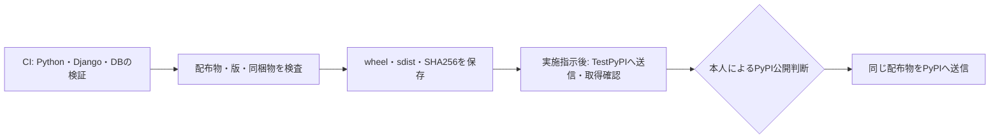

# リリースの準備と公開手順

更新日：2026-10-19。初回版は`0.1.0`。public化と外部設定を確認済み。TestPyPIへの送信・取得確認を有効化し、本番PyPIへは検証済みの配布物を使い、手動実行とenvironmentの承認を経て送信する。

## 現在実行できる準備

[Prepare release](../.github/workflows/prepare-release.yml)は、手動実行または他のワークフローからの呼び出しで、配布物の作成・メタデータ検査・新規インストール・SHA256の記録を行う。公開先への認証やアップロード処理は含めず、権限は`contents: read`に限る。予定タグ`v0.1.0`を渡して照合しても、Gitタグは作成しない。



編集元は[release-flow.mmd](assets/release-flow.mmd)。CI・Prepare release・TestPyPIへの公開ワークフローを有効にしている。手動のPrepare releaseはCIを自動で再実行しないため、候補として採用する際は同じcommitのCI成功も確認する。

### ローカルでの配布物検査

過去の版を同じ出力先へ混ぜず、版ごとに新しいディレクトリを使う。

```bash
uv sync --locked --extra orm
uv build --out-dir local-checks/release-0.1.0/dist
uv run --locked --extra orm twine check local-checks/release-0.1.0/dist/*
python3 scripts/check_release.py --dist-dir local-checks/release-0.1.0/dist --manifest local-checks/release-0.1.0/release-manifest.json --tag v0.1.0
python3 scripts/check_release.py --verify --dist-dir local-checks/release-0.1.0/dist --manifest local-checks/release-0.1.0/release-manifest.json
```

ローカルの作業中のコードでは`source_commit`を空にする。GitHub Actionsで作るmanifestには、実際にチェックアウトしたcommitを記録する。

検査では、ソース・予定タグ・wheel・sdistの版、配布名、CHANGELOGの該当節、MITと`py.typed`の同梱、配布物のSHA256を確認する。誤ったタグ、別の版の混在、メタデータの不一致、同梱漏れ、ファイルの変更を拒否する。README等の表示は`twine check`で検査するが、外部リンク先まで取得して検証するものではない。

Actionsの成果物は`release-<version>-<commit>`の名前で30日間保存し、次を含む。

- `dist/`：wheelとsdist。
- `release-manifest.json`：版・予定タグ・commit・ファイル名・SHA256。
- `orm-install.json`・`type-install.json`：新規プロジェクトとextraなしの確認結果。

期限切れや修正によって作り直した配布物は、新しい候補として再確認する。TestPyPIで検証した後に、同じ候補として再ビルドしない。

## TestPyPIへの公開

[Publish](../.github/workflows/publish.yml)は`v*`タグのpushで起動する。タグは配布版と一致させる（`0.1.0`の場合は`v0.1.0`）。CIの成功後にPrepare releaseで配布物を一度だけ作り、TestPyPIへ送信する。取得したwheelのSHA256をmanifestと照合し、新規Djangoプロジェクトで動作を確認する。

`testpypi` environmentとTrusted PublisherによるOIDC認証を使う。`id-token: write`は送信jobだけに与える。通常のリリースタグでは本番へ送信しない。本番公開は以下の手動操作で行う。

構文検査は次のとおり。

```bash
actionlint -shellcheck= -pyflakes= .github/workflows/*.yml
```

## 決定した所有者・承認方針と本人の設定

PyPI・TestPyPIは本人の個人アカウントで所有し、追加メンテナーを置かない。GitHubでは`testpypi`と`pypi`を分け、本番の`pypi`は本人`nibuno`の承認を必須にする。この方針は了承済みである。

具体的な入力値と操作順序は、[本人が行う公開設定の手順](publishing-setup.md)にまとめた。アカウントの確認、public化、environmentと承認者、両サイトのpending publisher登録までを扱う。

2026-10-19にブラウザで両サイトのアカウント`nibu`、対象リポジトリの`publish.yml`と各environmentに対応するpending publisherを確認した。両environmentは`v*`タグに制限され、本番は`nibuno`の承認必須、自己承認可、管理者の承認回避は無効。本人の指示によりTestPyPIへのアップロードと取得確認を進める。

TestPyPIからの検証では、依存を通常のPyPIからロックどおりに導入し、対象パッケージだけをTestPyPIから`--no-deps`で取得する。ワークフローは取得したwheelのSHA256を準備済みmanifestと照合する。PyPIへの送信は、その確認に成功した同じwheel・sdistを対象にする。[TestPyPIの利用手順](https://packaging.python.org/en/latest/guides/using-testpypi/)、[PyPAの公開手順](https://packaging.python.org/en/latest/guides/publishing-package-distribution-releases-using-github-actions-ci-cd-workflows/)

## 0.1.0の本番公開

TestPyPIの実行[39173153474](https://github.com/nibuno/django-ninja-ulid/actions/runs/39173153474)で確認したartifact ID `12152919501`を使う。[固定したmanifest](../release-candidates/0.1.0.json)に、配布元commitとwheel・sdistのSHA256を記録した。

`publish.yml`を`v0.1.0-publish.1`タグに対して手動実行する。このタグは公開操作用であり、パッケージの版とソースタグ`v0.1.0`は変更しない。`v*-publish.*`タグのpushではTestPyPIへの再送信を起動しない。

```bash
gh workflow run publish.yml --ref v0.1.0-publish.1
```

`verify-promotion`が元の実行の成功、配布物のハッシュ、TestPyPIから再取得したwheelのハッシュを照合する。その後`pypi` jobが承認待ちになる。本人がrunのsummaryとmanifestを確認し、Review deploymentsで`pypi`を選びApprove and deployを押すと送信が始まる。承認後も送信直前に元のartifactを取得して照合し、再ビルドはしない。

artifactが失効・削除された場合やハッシュが異なる場合は停止する。別の配布物へ自動で差し替えない。この手動公開経路は0.1.0専用であり、次の版では元の実行・artifact・manifest・操作用タグを更新する。
